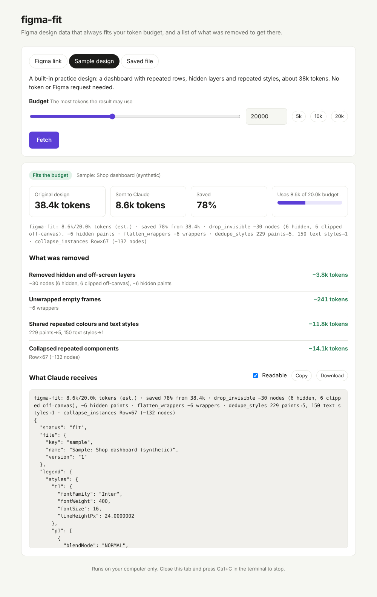
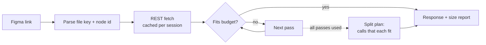

# figma-fit

[](https://github.com/methuliH/figma-fit/actions/workflows/ci.yml)
[](LICENSE)


**An MCP server that returns Figma design data guaranteed to fit your token budget, and tells you exactly what it removed to get there.**

```text
figma-fit: 8.6k/20.0k tokens (est.) · saved 78% from 38.4k · drop_invisible −30 nodes (6 hidden, 6 clipped off-canvas), −6 hidden paints · flatten_wrappers −6 wrappers · dedupe_styles 229 paints→5, 150 text styles→1 · collapse_instances Row×67 (−132 nodes)
{"status":"fit","file":{...},"legend":{"styles":{...},"conventions":{...}},"data":[...]}
```

<sub>Real output from the test suite's synthetic 38k-token frame at a 20k budget.</sub>

## 🤔 Why?

Figma responses regularly blow past what an agent can read:

- Claude Code users hit `get_design_context response (351378 tokens) exceeds maximum allowed tokens (25000)`. This is quoted on Figma's own known-issues page.
- A Figma forum user measured an API payload of about 960k tokens for a component that Figma's UI estimated at about 67k.

Existing compactors shrink responses but never promise a size. The official server falls back to a bare list of sublayers with no size estimates. figma-fit makes the budget a hard contract:

| | Official Figma MCP | Compaction servers | **figma-fit** |
|---|---|---|---|
| Output never exceeds the budget | ✗ | ✗ (best effort) | **✓** |
| Says what was removed | ✗ | ✗ / totals only | **✓ per pass** |
| Too big → sized follow-up calls | IDs only | ✗ | **✓ each call fits** |
| Runs without Figma Desktop | remote only | varies | **✓ REST API** |

The full analysis is in [PLAN.md](PLAN.md).

## ✨ Features

- **Hard budget.** Every response is measured on the exact text sent, report line included, and held under `budget`. When it can't fit, you get a split plan, never an oversized payload.
- **Itemized report.** The first line says what each pass removed and what it saved.
- **Sized split plans.** Frames too big for one response come back as a list of follow-up calls. Each call has an estimated size that fits.
- **Gentle on rate limits.** Each frame is fetched once per session. Follow-up calls are served from cache, which matters when a Starter-plan file allows about 6 requests a month.
- **Keeps detail when it can.** Passes stop as soon as the output fits, so a small frame comes back untouched.
- **Headless.** Uses the Figma REST API with a personal access token, so it works in CI, cloud agents and remote sessions.

## ⚡ Quick Start

1. Create a Figma personal access token with the `file_content:read` scope: **Figma → Settings → Security → Personal access tokens**.
2. Add the server to Claude Code:

   ```bash
   claude mcp add figma-fit -e FIGMA_TOKEN=<your-token> -- uvx --from git+https://github.com/methuliH/figma-fit figma-fit
   ```

3. In Figma, right-click a frame, choose **Copy link to selection**, and paste the link into Claude:

   ```text
   Build this pricing section in React: https://www.figma.com/design/AbC123/Shop?node-id=12-1
   ```

<details>
<summary>Cursor, Claude Desktop and other MCP clients</summary>

Add this to the client's MCP config (for example `.cursor/mcp.json` or `claude_desktop_config.json`):

```json
{
  "mcpServers": {
    "figma-fit": {
      "command": "uvx",
      "args": ["--from", "git+https://github.com/methuliH/figma-fit", "figma-fit"],
      "env": { "FIGMA_TOKEN": "<your-token>" }
    }
  }
}
```

</details>

<details>
<summary>From a local checkout</summary>

```bash
git clone https://github.com/methuliH/figma-fit && cd figma-fit
claude mcp add figma-fit -e FIGMA_TOKEN=<your-token> -- uv run --directory "$PWD" figma-fit
```

</details>

## 👀 Try It in Your Browser

No Claude needed, and no token needed for the built-in sample:

```bash
uvx --from git+https://github.com/methuliH/figma-fit figma-fit ui
```

A page opens where you paste a Figma link (or pick the sample, or a saved file), choose a budget, and see what Claude would get: the size before and after, what each step removed, the split plan when it doesn't fit, and the exact output, ready to copy.



The page runs only on your computer. A token typed into it is kept in memory until you close figma-fit.

Prefer the terminal? (From a clone, put `uv run` in front.)

```bash
figma-fit fetch --sample                       # the built-in sample
figma-fit fetch "<frame link>" --budget 15000  # a real frame (needs FIGMA_TOKEN)
figma-fit fetch --capture saved.json --report  # a saved response, size line only
```

## 🏃 Usage

The server exposes two tools. Keeping the list short keeps tool-definition cost low.

| Tool | Arguments | Use |
|---|---|---|
| `fetch_within_budget` | `url`, `budget` = 20000, `passes`, `plan_offset`, `refresh` | Main tool: fit a frame, or get a split plan. |
| `fetch_node_within_budget` | `file_key`, `node_ids`, `budget`, `passes`, `plan_offset` | The follow-up calls a split plan lists. Served from cache. |

- `budget` is the maximum number of tokens in the response. The minimum is 1000.
- `passes` restricts compaction to a subset, e.g. `["drop_invisible", "minify"]`.
- `plan_offset` pages through a split plan too long to list in one response.
- `refresh` re-fetches the frame from Figma instead of the session cache, e.g. after the design changed. It costs one request. A new file version also clears everything cached from the old one, so follow-ups never mix versions.

**Links must point at a frame.** A link without `node-id` is refused, because whole files are exactly the case that blows every budget. Design, prototype and branch links all work. FigJam, Slides and Make links are refused.

### When a frame is too big: split plans

```text
figma-fit: 689/8.0k tokens (est.) · SPLIT: 252k of data does not fit, see calls · drop_invisible −100 nodes … · minify 445 default/empty values, …
```

```json
{
  "status": "split",
  "reason": "~252k tokens of data; even after all passes it does not fit 8.0k. Fetch it in the calls below.",
  "next": "Call fetch_node_within_budget(file_key=\"AbC123\", node_ids=<call.node_ids>, budget=8000) for each call. Follow-ups are served from cache.",
  "legend": { "conventions": { "in": "id of the parent frame the node sits in; …" }, "keys": { "box": "absoluteBoundingBox as [x, y, width, height]", … } },
  "parents": [
    { "id": "3:1", "name": "Screen", "type": "FRAME", "clip": true, "box": [0, 0, 1440, 29680], "fills": [{ "type": "SOLID", "color": "#03d642" }] }
  ],
  "calls": [
    { "node_ids": ["3:134"], "est_tokens": 5648, "layers": ["Section 0 (FRAME)"], "in": "3:1" },
    { "node_ids": ["3:168"], "est_tokens": 5667, "layers": ["Section 1 (FRAME)"], "in": "3:1" }
  ]
}
```

The agent makes each call in turn. `parents` keeps the layout of every frame that was split up (auto-layout direction, gap, padding, fills, size), and each call's `in` says which parent its layers sit in, so the pieces can be put back together. Small neighbouring layers are bundled into one call. A single layer too big for any call, such as a huge text block, is listed under `oversize` with the budget it would need. It is never sent as data.

## 🏗 How It Works



Passes run cheapest and most information-preserving first, and the loop stops as soon as the output fits:

| Pass | What it does | Loss |
|---|---|---|
| `drop_invisible` | Removes hidden and zero-opacity layers, layers outside a clipping frame or the requested frame, and hidden paints and effects | None for rendering |
| `flatten_wrappers` | Replaces a single-child frame or group that paints, clips and lays out nothing (and is placed like its child) with that child | None for rendering |
| `dedupe_styles` | Moves paints, effects and text styles used 2+ times into `legend.styles`; nodes refer to them as `"@p1"` | None |
| `collapse_instances` | A repeated component instance becomes `sameAs` the first one plus a JSON-pointer `diff` | None (the diff rebuilds the node) |
| `minify` | Drops default values, writes colours as hex and boxes as `[x, y, w, h]`, shortens long keys (listed in `legend.keys`), rounds floats to 2 decimals | Rounding (reported) |

The `legend` explains every convention, so the model never has to guess what `@p1`, `sameAs` or `box` means.

### The guarantee, precisely

- Tokens are estimated as **UTF-8 bytes ÷ 3.2** on the exact string returned. Dense JSON tokenizes worse than prose, so this is deliberately more pessimistic than the usual characters ÷ 4.
- Output is held to **80% of the budget** (`SAFETY = 0.8`), so an estimate up to 20% low still fits.
- A property-based test (`tests/test_fit.py`) throws random budgets at frames from a few thousand to a few hundred thousand tokens. It checks that no response exceeds the budget and that every planned follow-up call also fits.

> [!NOTE]
> The estimate has not yet been calibrated against real Claude token counts on real Figma files. Until it is, read the guarantee as "by estimate". Calibrating takes one command (see [Development](#-development)).

## ⚙️ Configuration

| Variable | Required | Description |
|---|---|---|
| `FIGMA_TOKEN` | yes (or `FIGMA_API_KEY`) | Figma personal access token with the `file_content:read` scope |
| `FIGMA_API_KEY` | | Accepted as an alias, so existing Framelink setups work unchanged |

## 📁 Project Structure

```text
src/figma_fit/
├── cli.py              # figma-fit command: serve (default), fetch, ui
├── server.py           # MCP server: the two tools and error messages
├── ui.py               # Local web server behind the browser page
├── web/index.html      # The browser page (self-contained)
├── samples/            # Built-in sample design (a saved Figma API response)
├── url.py              # Figma link → (file_key, node_id)
├── figma.py            # REST client and per-session subtree cache
├── fit.py              # Budget loop, fit and split responses (the guarantee lives here)
├── pipeline.py         # Generic pass runner: stop as soon as it fits
├── split.py            # Generic split planner: pack subtrees into calls that fit
├── report.py           # The one-line size report
├── tokens.py           # Serialization and pluggable token estimator
├── models.py           # Result types
└── passes/             # figma_*.py hold the Figma rules; generic_minify.py is format-agnostic
scripts/
├── record_fixture.py   # Capture a real frame for tests and calibration
└── calibrate.py        # Compare estimates with Anthropic's token counter
```

Only `passes/figma_*.py`, `url.py` and `figma.py` know about Figma. The pipeline, split planner and report work on any JSON tree, which is what lets figma-fit wrap other MCP servers later.

## 🧪 Development

```bash
uv sync
uv run pytest
uv run ruff check . && uv run ruff format --check .
```

Record a real frame. Captures go to the git-ignored `captures/`; scrub private names and text before moving one into `tests/fixtures/`:

```bash
FIGMA_TOKEN=... uv run python scripts/record_fixture.py "<figma frame link>" my_frame
```

Calibrate the estimator against real token counts. This needs `ANTHROPIC_API_KEY` or an `ant auth login` profile; token counting is free but rate-limited:

```bash
uv run --group calibrate python scripts/calibrate.py
```

It prints the estimate ÷ actual ratio for every capture and budget, and says whether the guarantee holds on your files.

## 🚧 Limits

- **Design files only.** FigJam, Slides and Make links are refused, because the passes are written for design-file layers.
- **The cache is per session.** A changed design is picked up only with `refresh: true` or a server restart.
- **Estimates, not exact counts.** Exact counting is on the v2 list.

Coming in v2: exact token counting, lossy passes that report every drop, a proxy mode for the official Figma MCP, and Notion support. See the [roadmap](PLAN.md#28-v2-backlog-in-priority-order).

## 📄 License

[MIT](LICENSE) © 2026 methuliH
